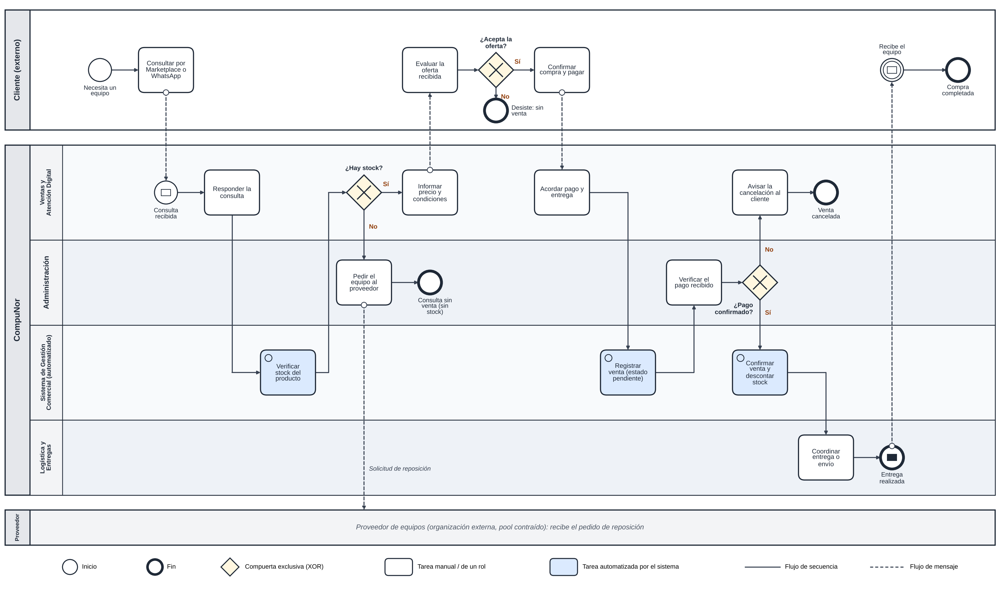

# CompuNor - Sistema de Gestión Comercial

Trabajo Práctico Integrador y Progresivo (TPI) de **Organización Empresarial**
Tecnicatura Universitaria en Programación a Distancia (TUP AD) - Universidad Tecnológica Nacional (UTN)

## Descripción del sistema

CompuNor es un emprendimiento dedicado a la venta de notebooks y teléfonos celulares nuevos y usados. La actividad se realiza principalmente por Marketplace y WhatsApp.

Este proyecto propone un **Sistema de Gestión Comercial** que reúna en un solo lugar la información principal del negocio:

- **Productos:** registro de equipos con marca, modelo, estado (nuevo/usado), costo, precio y número de serie o IMEI.
- **Inventario:** equipos disponibles y vendidos, con el stock siempre actualizado.
- **Clientes:** datos básicos e historial de compras.
- **Ventas:** qué se vendió, a quién, por cuánto, cuándo y con qué medio de pago.
- **Reportes:** ventas, productos disponibles y movimiento del inventario.

## Integrantes

| Integrante | Rol | Comisión |
|---|---|---|
| Tomás Ezequiel Aguirre | Responsable del negocio, análisis y documentación | 15 |

Profesora: Carolina Bruno - Tutora: María Lourdes Ricciuto

## Enlaces del proyecto

- Repositorio: https://github.com/kurokoATR/CompuNor
- Tablero ágil (GitHub Projects): https://github.com/users/kurokoATR/projects/1

## Estructura del repositorio

```
CompuNor/
├── README.md                          Portada del proyecto
├── docs/
│   ├── bpmn-compunor.png              Diagrama BPMN del proceso de venta
│   ├── bpmn-compunor.svg              Mismo diagrama en formato vectorial
│   ├── historias-de-usuario.md        Las 3 historias de usuario y sus criterios de aceptación
│   ├── indicadores-de-control.md      Indicadores y estándares de desempeño
│   └── flujo-git.md                   Ramas, commits y Pull Requests
├── .github/
│   └── pull_request_template.md       Plantilla de Pull Request
└── src/                               Código fuente (se desarrolla en la etapa de implementación)
```

## Proceso de negocio (BPMN)

El proceso que el sistema va a automatizar es la **venta de un equipo, desde la consulta del cliente hasta la entrega**. Está modelado en BPMN con pools (Cliente y Proveedor, externos; CompuNor) y lanes (Ventas y Atención Digital, Administración, Sistema de Gestión Comercial y Logística y Entregas). Incluye tres compuertas de decisión para las excepciones: sin stock, el cliente no acepta la oferta y pago no confirmado.



## Forma de trabajo con Git y GitHub

- La rama `main` contiene siempre la versión estable de la documentación.
- Cada cambio se hace en una **rama secundaria** (`docs/...`, `feature/...`) y llega a `main` mediante un **Pull Request** con revisión de otra persona.
- Los mensajes de commit son descriptivos, en español y con prefijo: `docs:`, `feat:`, `fix:`, `chore:`.

El detalle está en [`docs/flujo-git.md`](docs/flujo-git.md).

## Backlog ágil

El trabajo se organiza en el tablero de GitHub Projects con las columnas **Por Hacer**, **En Progreso** y **Listo**. Las tres historias de usuario están en [`docs/historias-de-usuario.md`](docs/historias-de-usuario.md).

## Control y desempeño

Los indicadores de control y los estándares de desempeño para la auditoría técnica del sistema están en [`docs/indicadores-de-control.md`](docs/indicadores-de-control.md). Son estándares propuestos: se van a medir cuando exista una versión del sistema para probar.

## Declaración de Uso de IA

Se usó un asistente de inteligencia artificial generativa (Claude, de Anthropic) como apoyo en la **Entrega N.º 4**. El caso CompuNor, las decisiones del negocio y el contenido de las entregas anteriores son de mi autoría.

**Para qué se usó:**

- Organizar la estructura de la entrega y del README.
- Proponer un primer borrador del diagrama BPMN y de las tablas de indicadores.
- Redactar un borrador de las historias de usuario a partir del diccionario de datos de la Entrega N.º 3.
- Revisar la redacción.

**Prompts utilizados y por qué:**

| Prompt (resumen) | Por qué lo formulé así |
|---|---|
| Adjunté las consignas del TP4 y mis tres entregas anteriores y pedí armar la Entrega 4 aclarando que ya tenía trabajo hecho en GitHub. | Para que el resultado salga del caso real de CompuNor y sea coherente con mis entregas, y no un texto genérico. |
| Pasé el enlace del repositorio. | Para que se contrastara lo que pide la consigna con lo que realmente había en GitHub (ramas, Pull Requests, README) antes de redactar. |
| Pasé el enlace del tablero. | Para vincular las historias de usuario con el tablero. La IA no pudo leerlo, así que esa parte la verifiqué yo. |

**Correcciones y controles humanos:**

- La IA detectó que el repositorio tenía solo la rama `main`, ningún Pull Request y un README sin declaración de IA. Corregí eso creando las ramas, abriendo y resolviendo un Pull Request con revisión de pares, y agregando esta sección.
- La IA no pudo acceder al tablero. Las capturas y los estados de las tarjetas los comprobé yo directamente en GitHub Projects.
- Los indicadores son estándares propuestos, no mediciones. Aclaré esa diferencia para no presentarlos como resultados ya conseguidos.
- COMPLETAR: agregar acá una o dos correcciones propias sobre el BPMN o las historias de usuario (por ejemplo, qué cambié para que coincida con cómo vendo realmente).

**Responsabilidad:** soy responsable de la veracidad y la coherencia de todo el contenido del repositorio.
